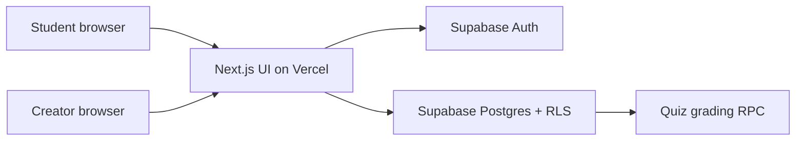
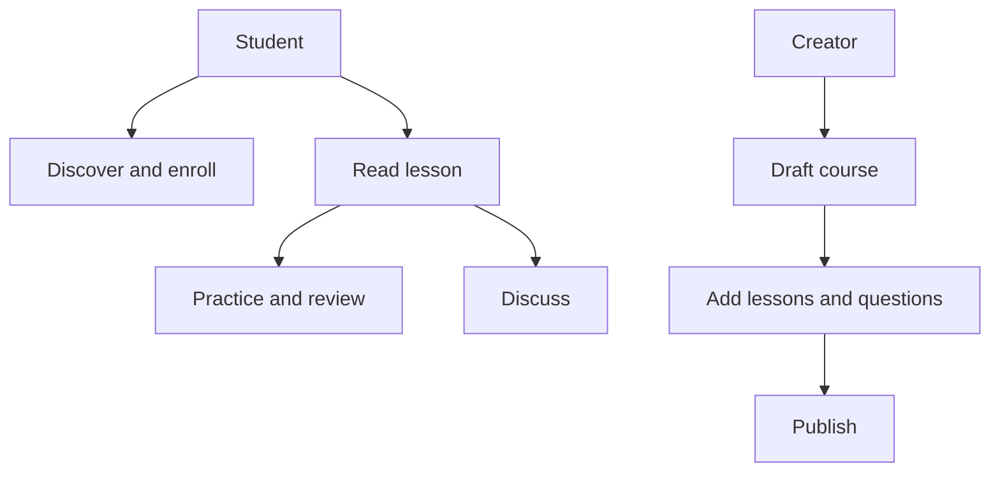
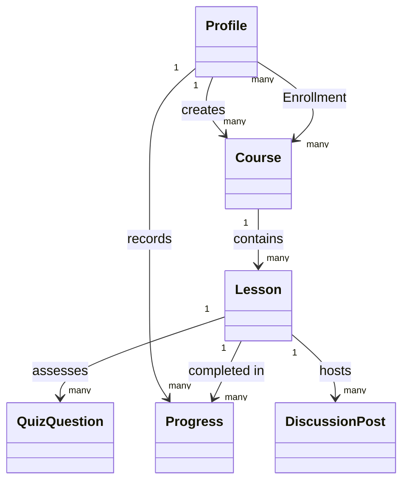
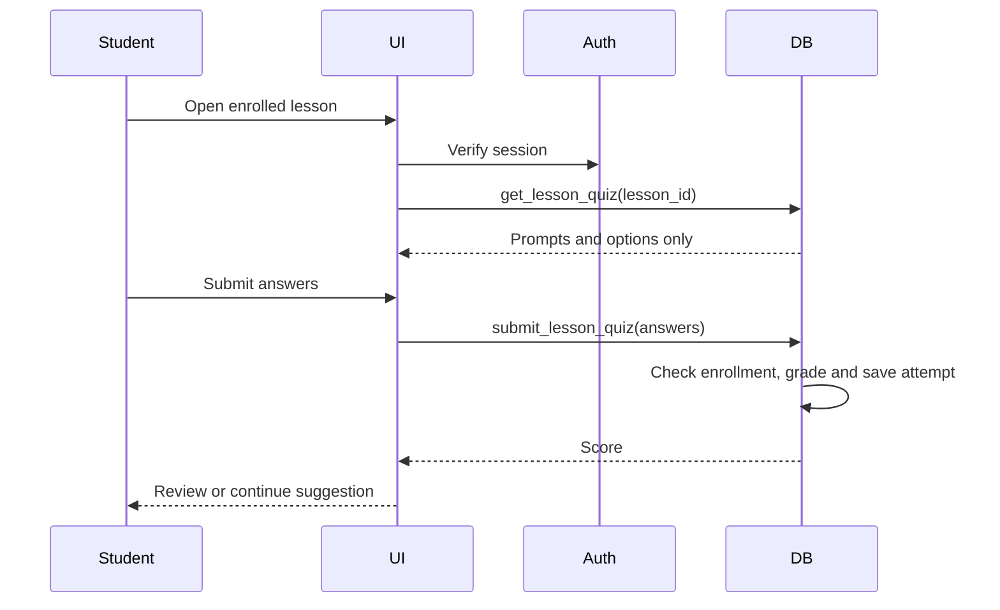

# Forma: FutureLearning Learning Engine — CCP baseline

**Scope:** a web platform where nontechnical creators publish structured courses and learners follow them with saved progress, practice and discussion. The delivered application is an initial product release, not a claim that all production-scale targets below have been measured.

## 1. Stakeholders and assumptions

- Learners need a clear path through a subject on desktop and mobile.
- Creators need to update courses without writing code.
- The company needs access control, observable progress and room to add content types.
- A three-person team works part-time over about five weeks. The first release uses linked HTTPS resources rather than large file uploads. Budget assumption: PKR 0–15,000 for prototype hosting and service usage, plus team time; revise after load testing and media storage estimates.

## 2. Requirements and rationale

| ID | Requirement | Why it matters | Release status |
|---|---|---|---|
| F1 | Sign up/sign in as student or creator | Personal learning history and author ownership | Implemented |
| F2 | Creators draft and publish categorized courses | Staff can change content without developer help | Implemented |
| F3 | Creators add and edit ordered text lessons with video/audio/resource links | Supports varied content with a simple editor | Implemented; file upload planned |
| F4 | Learners search/filter and enroll in published courses | Makes the catalog usable at scale | Implemented |
| F5 | Learners read lessons and resume with saved completion | Progress remains available across sessions | Implemented |
| F6 | Lesson quizzes provide scored feedback and a review/continue suggestion | Practice informs the next learning step | Implemented at lesson level; richer paths planned |
| F7 | Enrolled learners and creators discuss each lesson | Helps resolve questions in context | Implemented |
| F8 | Creators see aggregate course analytics and revise published lessons | Continuous improvement based on evidence | Implemented aggregates; detailed lesson analysis planned |
| F9 | Staff upload media and interactive simulations | Removes dependence on external content hosts | Planned extension |
| F10 | Learners set weekly goals, bookmark lessons and save private notes | Supports regular learning and personal recall | Implemented |
| F11 | Learners see practice history and weak-topic review suggestions | Helps prioritize the next study session | Implemented at lesson level |
| N1 | RLS separates private drafts, student progress, posts and answer keys | Protects user data and assessment integrity | Policies implemented; live security test required |
| N2 | Responsive interface; keyboard access, semantic controls, readable contrast | Makes lessons reachable across devices and abilities | Implemented baseline; WCAG audit required |
| N3 | Aim for 95th percentile page response under 3 seconds at 500 concurrent users | Defines a measurable growth target | Target, unverified |
| N4 | Aim for 99.9% monthly availability with backups and monitoring | Makes the platform dependable | Target, not provided by this repo alone |
| N5 | Content updates visible without redeployment | Makes frequent publishing practical | Implemented through database records |

The next step in adaptive learning should use prerequisite links, repeated weak-topic signals, and teacher-authored remediation paths. The current score threshold (<70% prompts review; >=70% prompts continuation) is a transparent starting rule, not an AI claim.

## 3. Architecture

The browser uses a publishable key. Supabase Auth supplies identity; RLS authorizes row access. The quiz RPC reads protected answer keys and stores attempts. Private notes, bookmarks and weekly goals are stored in separate RLS-protected tables; a creator-only RPC returns aggregate analytics without student identities. Never put a service role key in browser environment variables. Local demo data are visibly labeled and stored only in the browser.

### Use cases

### Core domain model

### Quiz sequence

## 4. Validation plan

| Test | Requirement | Action and expected result |
|---|---|---|
| T1 | F1, N1 | Create student account, confirm email, sign in/out; own session returns. |
| T2 | F2, N1 | Creator saves draft; public catalog does not show draft. Publish after adding a lesson; catalog shows it. |
| T3 | F3, N5 | Creator adds a text lesson and HTTPS resource; a second session sees the new content without a deploy. |
| T4 | F4 | Search by title and filter by category; enroll and reopen the course. |
| T5 | F5 | Complete a lesson, sign out/in; saved percentage remains. Another student cannot read or alter it. |
| T6 | F6, N1 | Student quiz payload has no answer key; incomplete submission fails; correct/incorrect submissions produce scores and stored attempts. |
| T7 | F7, N1 | Enrolled student posts; another enrolled student sees it. Unenrolled user cannot post or read. |
| T8 | N1 | Attempt cross-user edits and draft access using the publishable key; RLS denies. |
| T9 | N2 | Keyboard-only navigation, 320px/768px/desktop layouts, screen-reader labels and contrast audit. |
| T10 | N3 | Load-test 500 concurrent users against a production-like environment; report 95th percentile latency and bottlenecks. |
| T11 | N4 | Restore backup in staging and verify monitoring/alerting; measure uptime over an observation window. |
| T12 | F10, N1 | Save a note and bookmark, sign out/in; both persist and another student cannot read them. Change weekly goal and verify weekly count. |
| T13 | F8, N1 | Creator sees only own course aggregates; direct RPC call from student fails. |
| T14 | F11 | Submit a low score; review appears. Retry with passing score; old weak result no longer prompts review. |

T1–T8 and T12–T14 need a configured Supabase project and at least two real accounts. The local demo validates UI flow but does not substitute for permission testing. T9–T11 remain acceptance gates before a production rollout.

## 5. PERT/CPM project plan

Expected duration = (optimistic + 4 × most likely + pessimistic) / 6. Time unit: working day. Earliest start (ES) and finish (EF) start from day 0.

| ID | Activity | Depends on | O | M | P | Expected | ES | EF | Critical? |
|---|---|---|---:|---:|---:|---:|---:|---:|---|
| A | Requirements and scope | — | 1 | 2 | 3 | 2 | 0 | 2 | Yes |
| B | UX flows and design | A | 2 | 3 | 4 | 3 | 2 | 5 | No |
| C | Schema and data policies | A | 2 | 3 | 4 | 3 | 2 | 5 | Yes |
| D | Authentication and roles | C | 1 | 2 | 3 | 2 | 5 | 7 | Yes |
| E | Creator course workflow | B, D | 3 | 4 | 5 | 4 | 7 | 11 | Yes |
| F | Catalog, enrollment and lesson player | E | 3 | 4 | 5 | 4 | 11 | 15 | Yes |
| G | Quizzes, feedback and progress | F | 2 | 3 | 4 | 3 | 15 | 18 | Yes |
| H | Lesson discussion | F | 1 | 2 | 3 | 2 | 15 | 17 | No |
| I | Accessibility and responsive pass | G, H | 1 | 2 | 3 | 2 | 18 | 20 | Yes |
| J | Integration, security and load validation | I | 2 | 3 | 4 | 3 | 20 | 23 | Yes |
| K | Deployment and handoff | J | 0.5 | 1 | 1.5 | 1 | 23 | 24 | Yes |

**Critical path:** A → C → D → E → F → G → I → J → K = **24 working days**. B has 2 days of float; H has 1 day. Risks include email confirmation misconfiguration, RLS errors, creator content quality, external media availability and unexpected service limits. Mitigate with staged account tests, acceptance checks, resource validation and a deployment rehearsal.

## 6. Release boundary

The implemented core can become a real product with a Supabase project and Vercel deployment. The documented broader vision includes upload storage, richer accessibility, analytics, simulations, content governance, monitoring and tested scale. These are explicitly future work, rather than silently represented as finished features.
